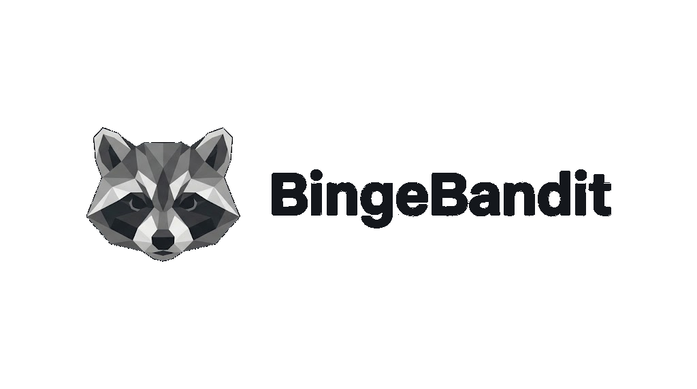

<p align="center">
  
</p>

**BingeBandit** is a self-hosted media server that aims to replace Plex, Jellyfin, Dispatcharr and ErsatzTV with one app: your movies and shows, live TV with a real guide and DVR, and custom TV channels built from your own library.

> Status: **Milestone 1 (core media server)** is working. See [docs/ROADMAP.md](docs/ROADMAP.md) for everything that's planned.

## What works today

- Movie and TV libraries from any folders, with automatic scanning (and periodic rescans)
- Filename parsing for `Movie (Year)`, scene-style names, `S01E02`, `1x02`, `Season 01/` folders and `{tmdb-12345}` hints
- TMDB metadata: posters, backdrops, logos, ratings, genres, cast & crew, trailers, collections, content ratings
- A Plex-style home: hero spotlight, Continue Watching (with next-episode "On Deck"), Recently Added and Recently Released
- Movie, show, season and episode pages; mark watched and unwatched; trailer playback
- A web player that plays directly when the browser can, otherwise transcodes to HLS with FFmpeg
  - quality switching, audio-track switching and text subtitles
  - resume, auto-play of the next episode, keyboard shortcuts
  - hardware encoding (NVENC, Quick Sync, VAAPI, AMF, VideoToolbox) and HDR→SDR tone mapping
- Users with admin and regular roles, an admin dashboard with Now Playing (local/remote, IP, direct vs transcode, source → target) and library stats
- **Live TV**: M3U and XMLTV sources, channels with automatic fallback streams, one shared provider connection per channel, a TV guide, a live player with a mini guide, Dispatcharr-style stats, a one-click import of an existing Dispatcharr setup, and M3U/XMLTV output for other apps
- Watchlist, playlists, watch history, profiles, server statistics, and intro/credits detection with Skip buttons
- **Plugins** that run as their own processes or containers and use a plugin API ([docs/PLUGINS.md](docs/PLUGINS.md)); Watchlist RSS, Hue Sync (lights follow the screen) and Cinemask Upgrades (find low-quality files and have Cinemask search for better ones) are bundled
- A single binary with the web UI embedded, for Windows, Linux, macOS and Docker/Unraid

## Run it

### Windows (from source)

Requirements: [Go 1.26+](https://go.dev/dl/), [Node 22+](https://nodejs.org/), and [FFmpeg](https://www.gyan.dev/ffmpeg/builds/) on your PATH.

```powershell
.\build.ps1
.\dist\bingebandit.exe
```

Open http://localhost:8484. The first visit asks you to create the admin account.

### Docker / Unraid

```bash
docker compose up -d
```

See [docker-compose.yml](docker-compose.yml) for media volumes and GPU passthrough. On Unraid, follow [docs/UNRAID.md](docs/UNRAID.md): it covers the container template, paths, hardware transcoding and the apps.

To put the TV app on a friend's or family member's TV in another home, see [docs/TV-SETUP.md](docs/TV-SETUP.md).

### Options

| Flag        | Env var       | Default                         |
| ----------- | ------------- | ------------------------------- |
| `-addr`     | `BB_ADDR`     | `:8484`                         |
| `-data`     | `BB_DATA_DIR` | `%AppData%\BingeBandit` / `~/.config/BingeBandit` |
| `-ffmpeg`   | `BB_FFMPEG`   | `ffmpeg` (from PATH)            |
| `-ffprobe`  | `BB_FFPROBE`  | `ffprobe` (from PATH)           |

Everything else (TMDB key, hardware encoder, transcode folder, scan interval…) is under **Settings** in the web UI.

## Develop

```powershell
# terminal 1: API server (rebuild after Go changes)
cd server; go run ./cmd/bingebandit -data ..\data

# terminal 2: web UI with hot reload, proxies /api to :8484
cd web; npm install; npm run dev
```

Then open http://localhost:5173.

To try Live TV without an IPTV subscription, run the bundled fake provider and add `http://localhost:8585/playlist.m3u` and `http://localhost:8585/epg.xml` as sources under Server → Live TV:

```powershell
cd server; go run ./cmd/fakeiptv
```

To try single sign-on, run the fake OpenID Connect provider and add it under Server → Settings → Single sign-on with issuer `http://localhost:8686`, client ID `bingebandit` and secret `dev-secret`:

```powershell
cd server; go run ./cmd/fakeoidc
```

To try importing, run the fake Plex + Tautulli + Trakt server and use Server → Import with `http://localhost:32400` and token `fake-plex-token`, or `http://localhost:8181` and API key `fake-tautulli-key`. For Trakt, start BingeBandit with `-trakt-api http://localhost:8282` and use client ID `fake-trakt-client` and secret `fake-trakt-secret` under Settings → Trakt:

```powershell
cd server; go run ./cmd/fakeplex
```

Read [docs/ARCHITECTURE.md](docs/ARCHITECTURE.md) before making big changes, and [HANDOFF.md](HANDOFF.md) for where things stand. The HTTP API for scripts and apps is described in [docs/API.md](docs/API.md).

## Releasing

Push a tag such as `v0.1.0`. GitHub Actions then builds binaries for Windows, Linux and macOS, attaches them to a GitHub Release, and publishes a multi-arch Docker image to `ghcr.io/<owner>/bingebandit`.

## License

BingeBandit is licensed under the [GNU Affero General Public License v3.0](LICENSE). You can use, modify and share it. If you distribute a modified version, or run one as a service for others, you must publish your changes under the same license.

The BingeBandit name, raccoon logo and the artwork in [`Brand/`](Brand) and `web/public/brand/` are not covered by the AGPL. Please don't use them for your own forks or products without permission.
