# BingeBandit user guide

This guide walks through BingeBandit from a fresh install to a server the whole household uses: adding your media, watching it, setting up Live TV, giving everyone their own profile, keeping kids to what you've approved, and putting the apps on your TVs.

> The screenshots use made-up sample titles with generated artwork, so your server will look the same but with your own posters.

**Contents**

1. [Install](#1-install)
2. [First run](#2-first-run)
3. [Add your libraries](#3-add-your-libraries)
4. [Find something to watch](#4-find-something-to-watch)
5. [Watch](#5-watch)
6. [Collections and poster overlays](#6-collections-and-poster-overlays)
7. [Live TV and recordings](#7-live-tv-and-recordings)
8. [People: users, profiles and PINs](#8-people-users-profiles-and-pins)
9. [Kid mode](#9-kid-mode)
10. [TVs, phones and other devices](#10-tvs-phones-and-other-devices)
11. [Running the server](#11-running-the-server)
12. [Moving from Plex](#12-moving-from-plex)
13. [Troubleshooting](#13-troubleshooting)

---

## 1. Install

BingeBandit is a single program with the web app built in. Pick whichever fits your setup:

| Where | How |
|---|---|
| **Unraid** | Use the template. [docs/UNRAID.md](UNRAID.md) covers the paths, GPU transcoding and the apps step by step. |
| **Docker** | `docker compose up -d` with the [docker-compose.yml](../docker-compose.yml) in this repo. Mount your media at `/media` and your appdata at `/config`. The image is `ghcr.io/spacegoose02/bingebandit`. |
| **Windows, Linux, macOS** | Download the binary for your system from the [latest release](https://github.com/Spacegoose02/BingeBandit/releases/latest) and run it. FFmpeg needs to be on your PATH. |

Then open `http://<server-ip>:8484` in a browser. Keep port 8484: the TV and phone apps look for servers on it.

## 2. First run

The first visit asks you to create the admin account. If you're moving from another BingeBandit server, choose **Restore a backup** instead and upload the backup file.

<p align="center">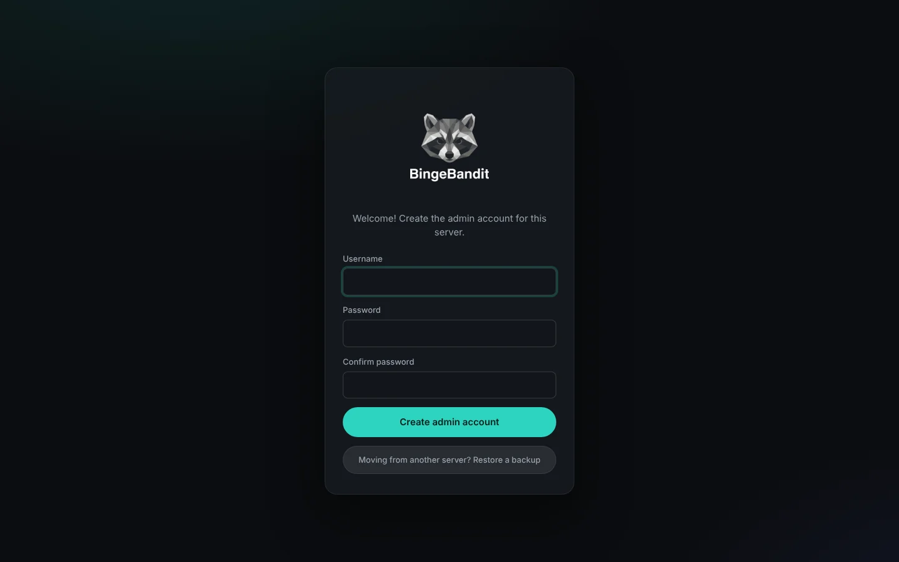</p>

Next, give BingeBandit a TMDB key so it can fetch posters, descriptions, cast and trailers:

1. Get a free API key at [themoviedb.org/settings/api](https://www.themoviedb.org/settings/api).
2. Go to **Server → Settings → Metadata** and paste it into **TMDB API key or read access token**.

The same section has optional keys for TheTVDB (for shows that use aired, DVD or absolute episode order) and MDBList (for list-based collections and ratings).

## 3. Add your libraries

Go to **Server → Libraries → Add library**. Choose **Movies** or **TV Shows**, give it a name, and pick one or more folders. You can add as many libraries as you like, for example separate ones for kids' movies or anime.

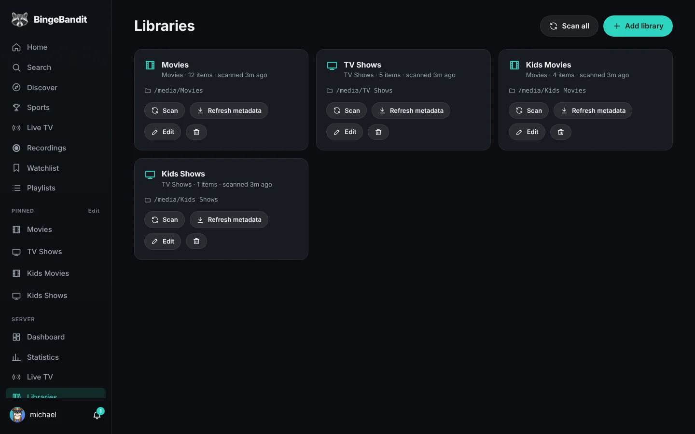

BingeBandit matches files by their names. It understands most common layouts, but these work best:

```
Movies/Movie Title (2024)/Movie Title (2024).mkv
TV Shows/Show Name (2023)/Season 01/Show Name - S01E01.mkv
```

Scene-style names, `1x02` and `{tmdb-12345}` hints in a folder name also work. If something matches the wrong title, open it and use **Fix match** (the magnifying glass button).

Other options when adding a library:

- **Detect intros and end credits** powers the **Skip Intro** and **Skip Credits** buttons.
- **Collections on the Library tab** decides whether a collection shows as its own poster, its movies show separately, or both.

New and changed files are picked up automatically while BingeBandit is running, and a full rescan runs every few hours (see [Scheduled tasks](#scheduled-tasks-and-backups)).

## 4. Find something to watch

### Home

Home opens with a spotlight of recent titles, then **Continue Watching** (including the next episode of shows you're partway through), and rows from each of your pinned libraries.

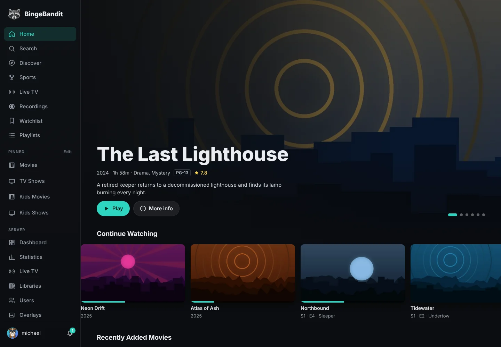

Libraries you pin sit in the sidebar and fill your Home. Use **Edit** next to **Pinned** to choose which ones and their order. Unpinned libraries stay under **More**.

### Libraries

Each library opens on **Recommended**, with tabs for the whole **Library** and its **Collections**. Admins can use **Manage recommendations** to pick which rows appear here and on Home.

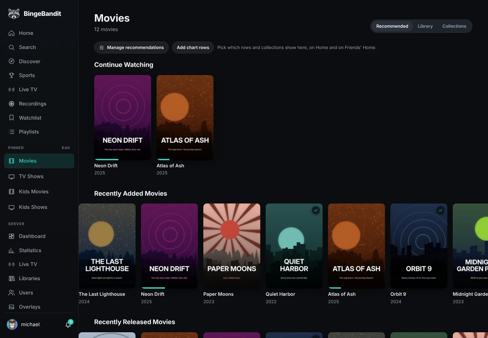

### Movie and show pages

A title's page shows its details, ratings, cast, the file's quality and audio and subtitle tracks, plus buttons to play or resume, mark watched, add to your watchlist or a playlist, and (for admins) edit details and artwork.

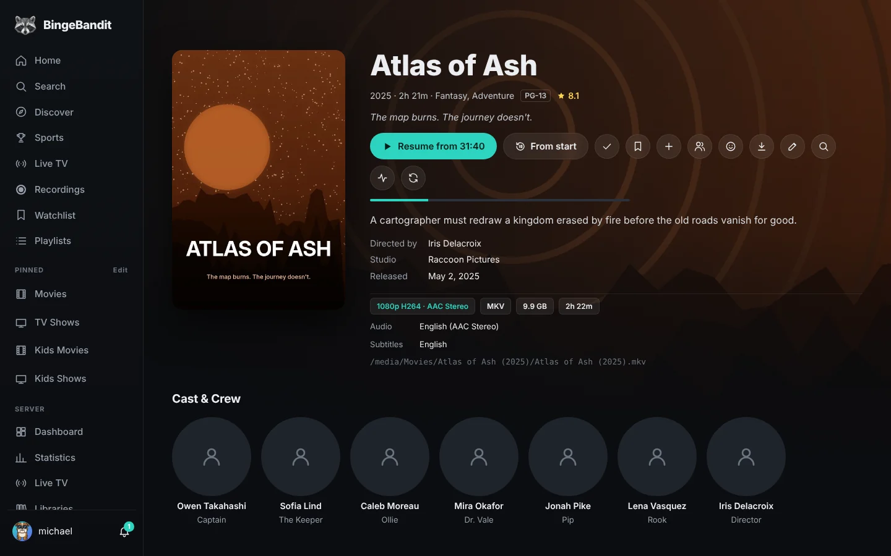

Shows list their seasons, and each season lists its episodes with a ✓ on the ones you've seen.

| Show | Season |
|---|---|
| 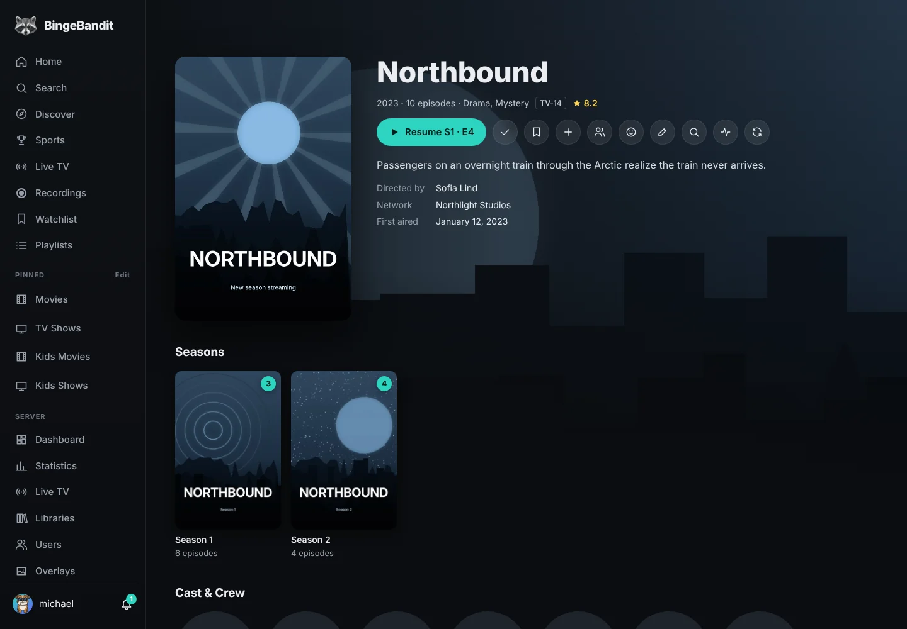 | 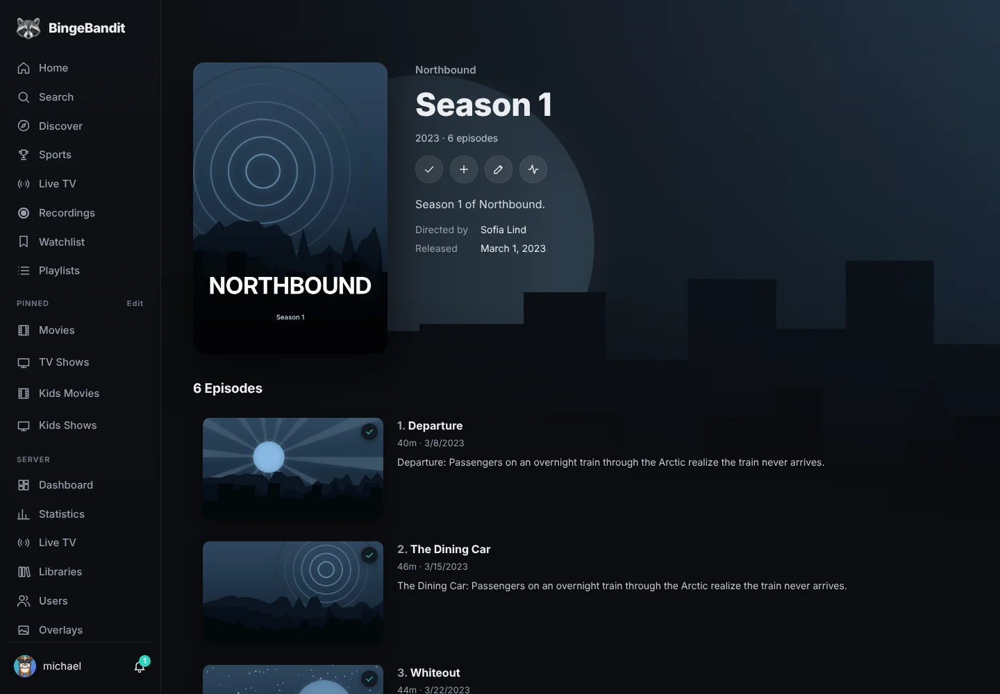 |

### Search, watchlist and playlists

- **Search** looks across every library you can see.
- **Watchlist** keeps titles you want to get to. Movies leave it once you finish them.
- **Playlists** are your own lists, and can be shared with others on the server.
- **Discover** shows new trailers and videos from YouTube playlists and channels an admin picks.

## 5. Watch

The web player plays a file directly when your browser can, and otherwise converts it on the fly. While watching you can:

- switch quality, audio track and subtitles,
- skip intros and credits,
- carry on to the next episode automatically,
- start **Watch Together** to watch in sync with someone else on the server.

Your position is saved as you go, so you can stop on one device and resume on another.

Your playback defaults (audio and subtitle language, when to show subtitles, subtitle size) are on your **Account** page under **Playback**.

## 6. Collections and poster overlays

A collection groups titles, such as a film series. BingeBandit creates collections from TMDB automatically, and admins can make their own from a library's **Collections** tab or from a title's **Edit → Tags**.

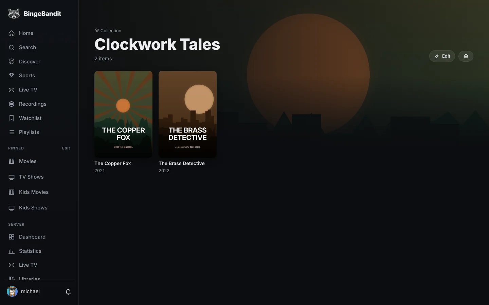

A collection can also fill itself:

- **Smart rules** pick titles by genre, studio or network, year range, or label.
- **Lists** follow TMDB, Trakt, IMDb or MDBList lists and charts, and update when the list changes.

**Server → Overlays** adds Kometa-style badges to posters, such as 4K, Dolby Vision, HDR, Atmos and ratings, or your own images. Your original artwork is never changed, and turning overlays off brings the plain posters straight back. This page also sets up the default collections.

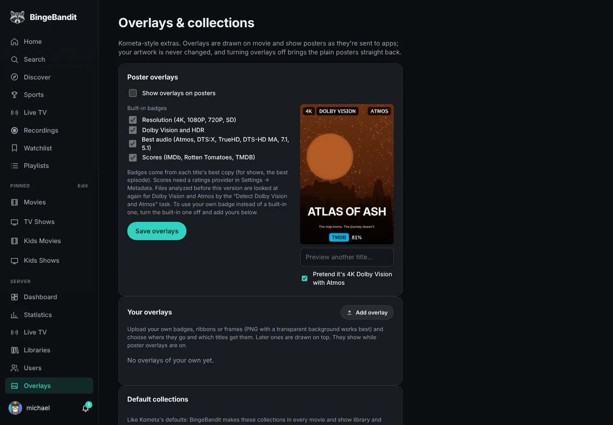

## 7. Live TV and recordings

BingeBandit can replace Dispatcharr or an HDHomeRun setup. It reads your IPTV provider's M3U playlist and XMLTV guide, builds channels from them, and shows a guide like a cable box.

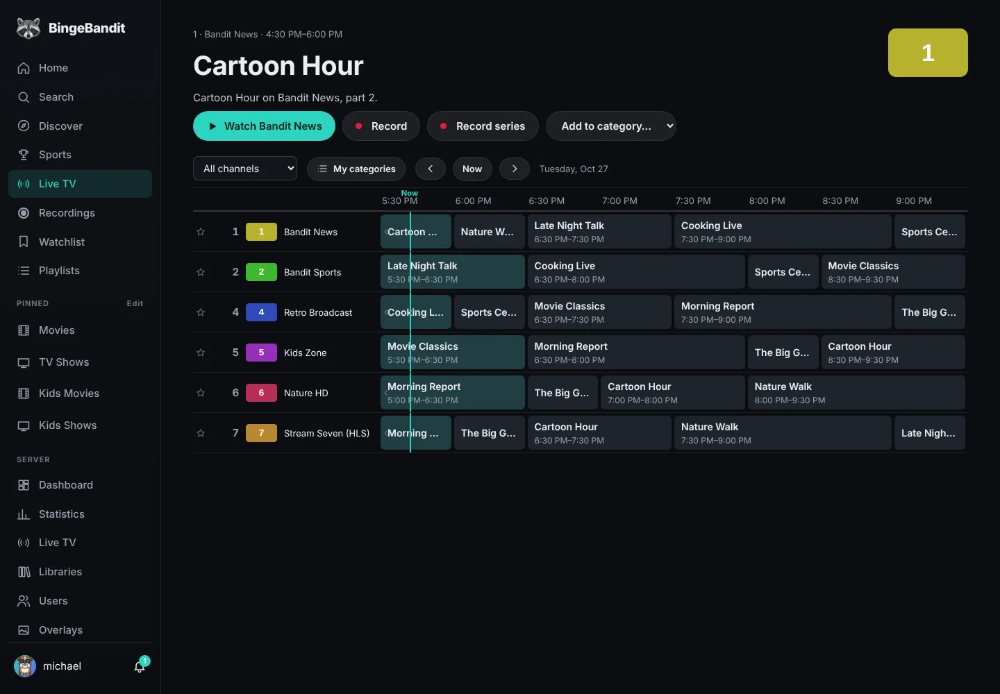

### Setting it up

1. Go to **Server → Live TV → Sources** and add your **M3U** playlist and your **XMLTV** guide. Set **Max streams** to your provider's connection limit.
2. Go to the **Channels** tab, choose **Add channels**, and pick the streams you want. Each channel can have backup streams; if one fails, BingeBandit switches to the next.
3. Use **Edit** on a channel to change its number, name, logo or guide data. The editor previews the next few hours of the guide so you can check the match.

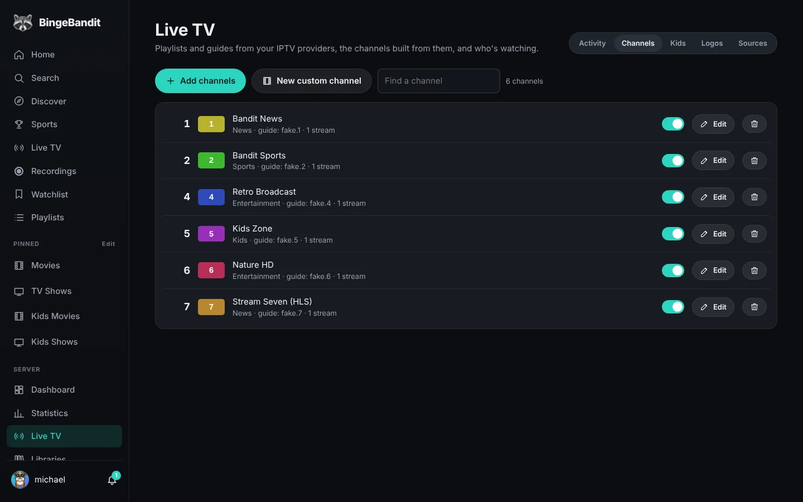

Already using Dispatcharr? **Import from Dispatcharr** on the Live TV page brings over its provider accounts, guides and channels in one go.

Other things on the Live TV page:

- **New custom channel** builds a 24/7 channel from your own movies and shows, like ErsatzTV.
- **Logos** holds channel logos and can match them to channels automatically.
- **Kids** picks which channels kid profiles can watch (see [Kid mode](#9-kid-mode)).
- **Activity** shows who's watching and how each stream is doing.
- **Use these channels in other apps** gives you M3U and XMLTV addresses for other players, and a tuner address for Plex's Live TV.

### Recording

Pick a programme in the guide and choose **Record** or **Record series**. Upcoming, series and finished recordings are on the **Recordings** page. Recording settings, including where files go, are under **Server → Settings → Live TV recording (DVR)**.

## 8. People: users, profiles and PINs

There are two ways to give someone their own space. Both keep a separate Continue Watching, history, watchlist and settings.

| | Use it for | Where |
|---|---|---|
| **Profile** | People in your home who share your sign-in | **Account → Profiles → Add profile** |
| **User** | People who sign in on their own, often in another home | **Server → Users → Add user** |

When an account has profiles, BingeBandit asks **Who's watching?** when it opens. A profile can have a 4 to 8 digit PIN to keep it private. The PIN for the main profile is your **settings passcode**, which also locks the admin and account pages.

<p align="center">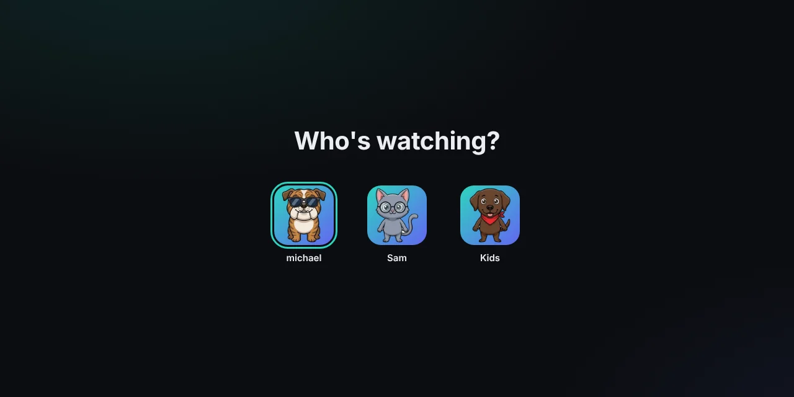</p>

On **Server → Users** an admin can, for each person:

- limit which libraries they see,
- turn Live TV on or off,
- turn on kid mode,
- add their email so single sign-on (for example Google or Authentik) links to them automatically,
- link a separate account under another one as a profile.

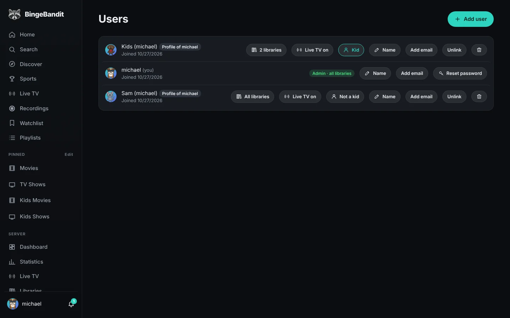

Signing in can also use passkeys, two-step codes, or single sign-on set up under **Server → Settings → Single sign-on**.

## 9. Kid mode

Kid mode is for profiles or users who should only see what a grown-up picked. Turn it on with the **Kid** option on the profile (on your **Account** page) or with the **Kid** button on **Server → Users**.

A kid sees:

- only the libraries you allow them,
- **Approved Movies** and **Approved Shows**: titles you've approved for them,
- only the Live TV channels approved for kids.

| Kid profile Home | Approved Movies |
|---|---|
| 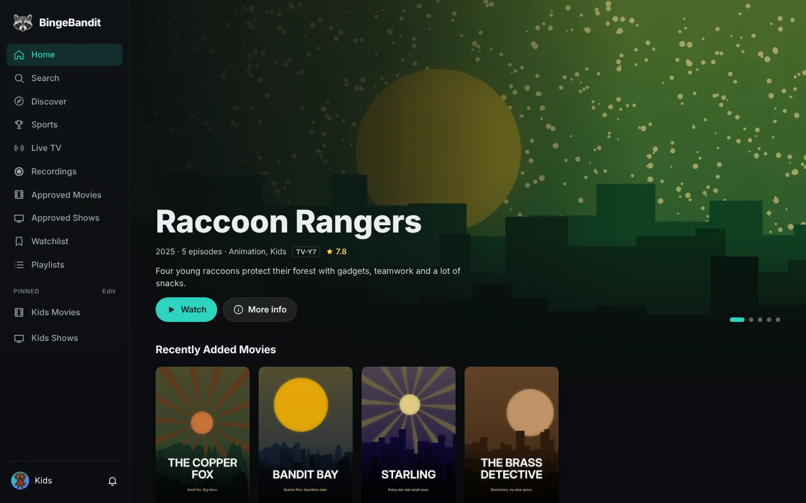 | 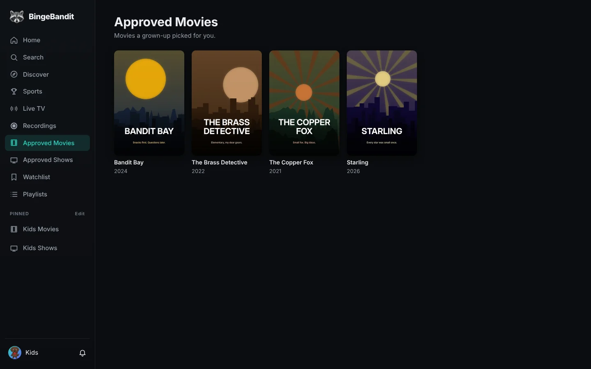 |

To approve something, open a movie or show and press the smiley **Approve for kids** button, then tick the kids it's for. On a collection's page, **Approve for kids** approves everything in it, including titles added to it later. Kids' channels are picked under **Server → Live TV → Kids**.

A good setup is a **Kids Movies** and **Kids Shows** library that only the kid profiles can see, plus approvals for anything else you're happy with.

## 10. TVs, phones and other devices

### Browsers and phones

The web app works on phones and tablets too, with tabs along the bottom.

<p align="center">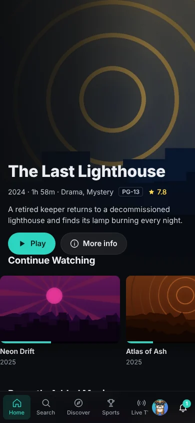</p>

### Android TV, Google TV, Fire TV and Android phones

The BingeBandit app runs on Android TV, Google TV, Fire TV and Android phones. Download `BingeBandit-TV-<version>.apk` from the [latest release](https://github.com/Spacegoose02/BingeBandit/releases/latest) (on a TV, the free **Downloader** app makes this easy). The app updates itself after that. See [apps/tv/README.md](../apps/tv/README.md) for what it can do.

### Roku

There's an early Roku channel that has to be sideloaded with the Roku in developer mode. See [apps/roku/README.md](../apps/roku/README.md).

### Signing in a TV

TVs never need a password typed on the remote. The app finds your server on the home network (or you type its address) and shows a code. On your phone, go to **Link a device** (`/link` on your server), enter the code and pick which account and profile the TV should use.

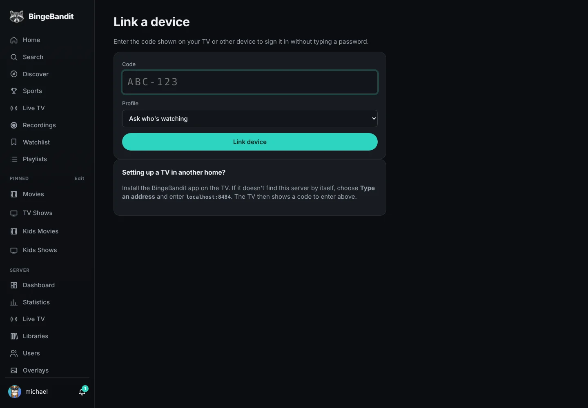

To set up a TV in someone else's home, follow [docs/TV-SETUP.md](TV-SETUP.md). It covers making your server reachable from outside, installing the app, and linking it.

### When the internet is down

BingeBandit keeps working on your home network without the internet. Signing in with a password, PIN or TV code, browsing, and playing your own files only need the server.

- **Apps switch addresses on their own.** The Android, Fire TV and Roku apps remember both your server's home address (like `192.168.1.10:8484`) and its public URL, and use whichever answers. A TV linked with your public URL finds the server on the home network when the internet is out, and a phone linked at home uses the public URL on the road. A TV linked with the public URL looks for the home address once a day while it's on Wi-Fi or Ethernet.
- **Make your public URL work at home too (optional).** If you open BingeBandit in a browser at `https://tv.example.com`, that name needs the internet to look up. Add a local DNS entry for it in your router or Pi-hole (for example `tv.example.com → 192.168.1.10`, the machine running your reverse proxy) so the same address keeps working at home. Browsers can always use `http://<server-ip>:8484` directly.
- **Artwork is saved ahead of time.** The **Cache artwork** task downloads posters, backgrounds and logos after each library scan, so they show without the internet.
- **What needs the internet:** single sign-on (Google and other OIDC providers), passkeys made on your public address (they belong to that name, and browsers only allow passkeys on `https` or `localhost`), metadata for newly added files, ratings, Trakt, Discover, sports scores, Live TV channels from internet providers, and the plugin catalogue and app updates. Keep a password (or a PIN profile) for at least one account so someone can always sign in at home.

## 11. Running the server

### Dashboard

**Server → Dashboard** shows library totals and **Now Playing**: who's watching what, on which device, from home or away, and whether it's playing directly or being converted.

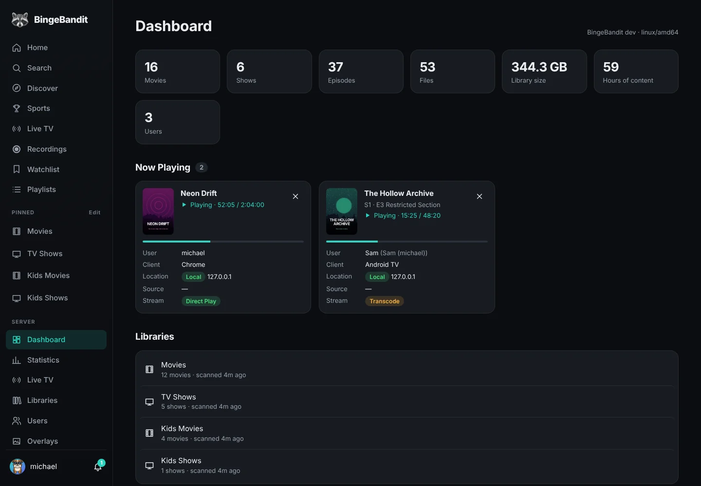

### Statistics

**Server → Statistics** charts plays per day and shows top movies, shows and viewers, plus a full watch history.

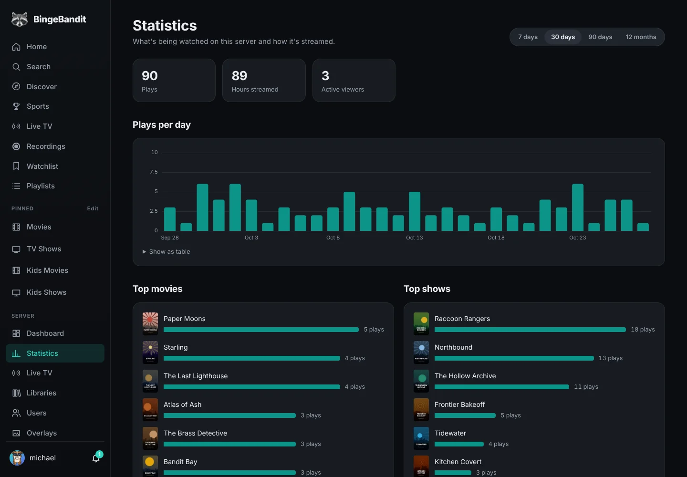

### Settings

The main sections under **Server → Settings**:

- **Transcoding:** hardware encoding (NVIDIA NVENC, Intel Quick Sync, VAAPI, AMD AMF, VideoToolbox), HDR to SDR tone mapping, and the transcode folder.
- **Network:** your public URL, trusted reverse proxies, and extra networks that count as home.
- **Metadata:** TMDB, TheTVDB, MDBList and the ratings provider.
- **Trakt** and **Webhooks:** sync watch history with Trakt, and notify other services (Home Assistant, Discord bots, n8n) when things happen.

### Scheduled tasks and backups

**Server → Tasks** lists background jobs such as library scans, guide refreshes, metadata refreshes and database backups, with how often each runs and a **Run now** button. Backups are kept locally and can also be copied to S3-compatible cloud storage. **Restore a backup** is at the bottom of this page.

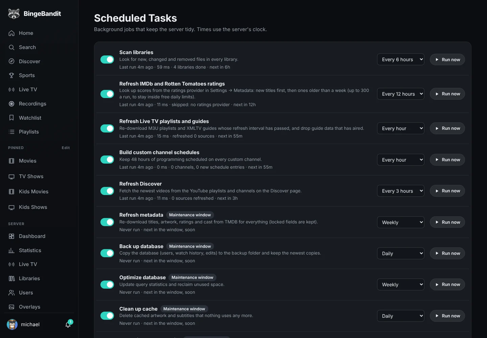

### Plugins

**Server → Plugins** installs add-ons from the catalogue, such as Watchlist RSS, Hue Sync (Philips Hue lights follow the screen), Game Lights and Cinemask Upgrades. To write your own, see [docs/PLUGINS.md](PLUGINS.md).

## 12. Moving from Plex

**Server → Import** brings over watch history, watched marks, collections and posters from Plex or Tautulli, and lets you choose whose history goes to which BingeBandit user. Trakt history can be imported from your **Account** page.

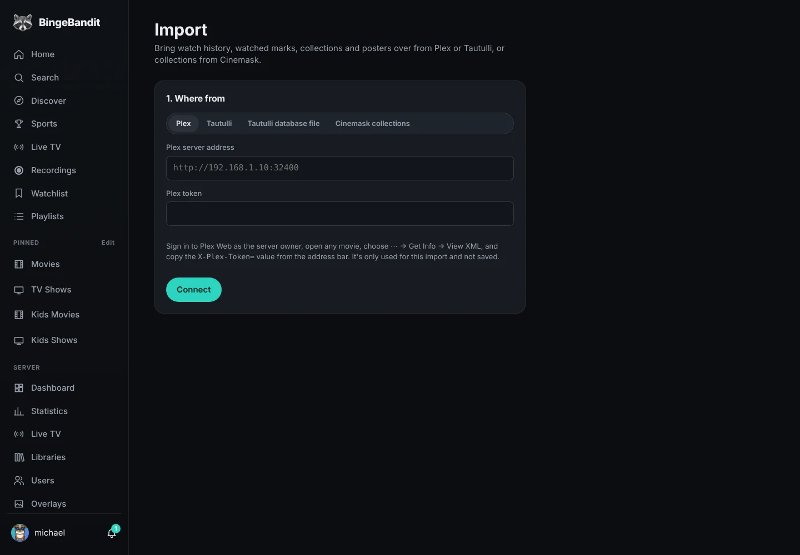

## 13. Troubleshooting

- **A title has the wrong poster or name:** open it and use **Fix match**. Renaming the folder to `Title (Year)` also helps.
- **No posters at all:** check the TMDB key under **Server → Settings → Metadata**, then use **Refresh metadata** on the library.
- **Playback stutters:** turn on hardware encoding under **Server → Settings → Transcoding**, or pick a lower quality in the player. Away from home, your upload speed is usually the limit.
- **A TV can't find the server:** make sure the TV is on the same network and port 8484 is open, or choose **Type an address** in the app.
- **Something else:** **Server → Logs** shows what the server is doing. Please open an [issue](https://github.com/Spacegoose02/BingeBandit/issues) with what you see there.

For scripts and your own apps, the HTTP API is described in [docs/API.md](API.md).
